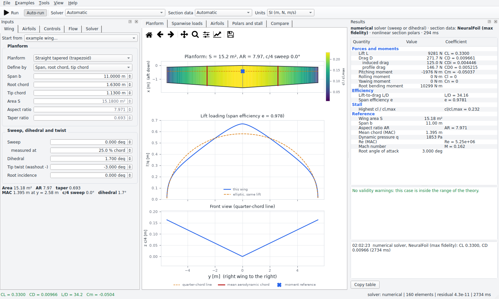
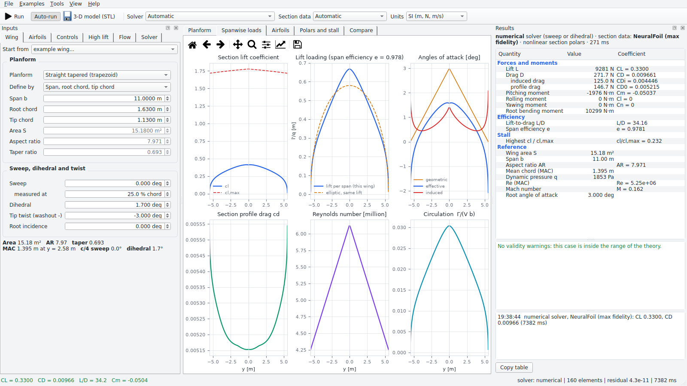
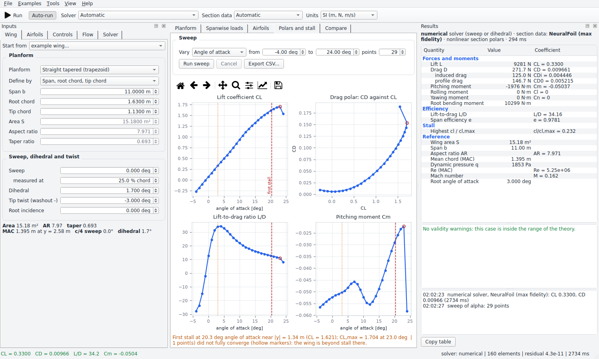
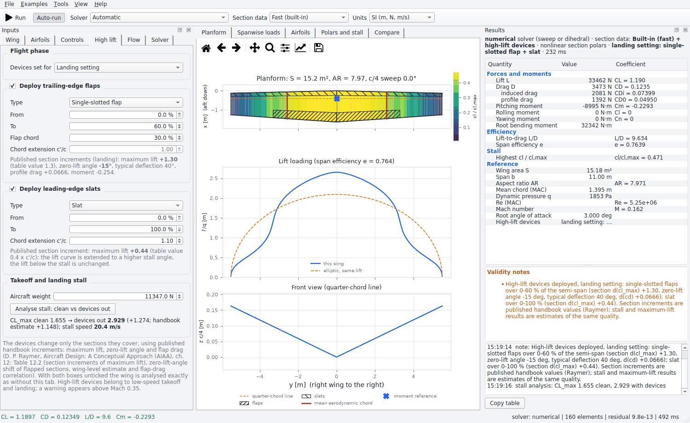

# Lifting-Line Wing Calculator

An offline desktop program that computes the **lift, drag and moments of a wing** from **Prandtl's lifting-line theory**.
Describe the wing (planform, sweep, dihedral, twist), give it airfoils (a **NACA 4-, 5- or 6-series code**, or a **UIUC
`.dat` file** from your own copy of the coordinate database), set the freestream (altitude or density, speed or Mach,
angle of attack, sideslip, ground proximity ...) and read off forces, moments, spanwise loads, stall margin and polars.



Everything runs on your machine. The optional **max-fidelity** airfoil data come from [NeuralFoil](https://github.com/peterdsharpe/NeuralFoil)
(an XFOIL-quality neural surrogate that works offline once installed); a lighter built-in engine is always available, and you
choose between them with one drop-down.

- [Install](#install) · [Quick start](#quick-start) · [Using the program](#using-the-program) · [Conventions](#conventions)
- [How it works](#how-it-works) · [Validation and accuracy](#validation-and-accuracy) · [Limitations](#limitations)
- [Tools](#tools) · [Development](#development)

## Install

You need Python 3.10 or newer. One command installs everything, including the max-fidelity airfoil engine:

```bash
pip install -r requirements.txt
python main.py
```

* **Lighter install** - delete the two `neuralfoil` / `aerosandbox` lines of `requirements.txt` (or install only
  `numpy scipy matplotlib PySide6`). The program then uses the built-in section engine and says so; nothing else changes.
* **Linux** - Qt needs the system OpenGL/EGL libraries (`sudo apt install libegl1 libopengl0` on Debian/Ubuntu).
* **No network is needed at run time.** The UIUC airfoil database is *not* downloaded by the program: point it at the folder you
  already have (Solver tab -> Airfoil library, or Tools -> Airfoil library folder).
* Check the installation any time with `python -m liftingline --validate` (70 checks, about 3 seconds) or from
  *Help -> Run the self-test*.

## Quick start

The program opens with an example wing (a light-aircraft wing) already analysed. To analyse your own:

1. **Wing tab** - choose the planform (straight tapered, elliptic, or a free table of sections), enter the dimensions in the
   way that suits you (span and chords, area and aspect ratio ...), then sweep, dihedral, twist and root incidence. Pick one
   of the *example wings* to start from something familiar.
2. **Airfoils tab** - type a code such as `NACA 2412`, `23012`, `63-412` or `64A010`, or choose a file or a library entry
   (*Library...*, *Open .dat...*). The line below the table tells you what the code resolved to.
3. **Flow tab** - altitude (ISA) or your own density, speed or Mach number, angle of attack, sideslip.
4. Results appear on the right; with **Auto-run** on (default) they update a moment after every change. **Ctrl+R** runs now.

The toolbar picks the **solver** (Automatic: the classical Prandtl solution whenever it applies), the **section data**
(NeuralFoil or built-in) and the **units** (SI or imperial).

## Using the program

### Wing

| Input | Notes |
|---|---|
| Planform | *Straight tapered*: root and tip chord; *Elliptic*: the exact Prandtl optimum; *Free table*: any number of sections (y, chord, leading-edge x, c/4 height, twist). |
| Define by | Span + chords, area + aspect ratio + taper, span + area + taper, or span + aspect ratio + taper. The other numbers are calculated and shown. |
| Sweep | Positive = swept back, measured along any chord fraction you choose (leading edge, quarter chord, trailing edge ...). |
| Dihedral, twist | Dihedral positive = tips up. Twist is at the tip relative to the root, nose-up positive (washout is negative). |
| Root incidence | Added to the flow angle of attack. |

### Airfoils

* **NACA 4-digit and 5-digit** sections are generated exactly. **6- and 6A-series** codes (`63-412`, `63412`, `63(2)-415`, `65(216)-415`,
  `64A010` ...) are looked up in your library by a canonical key, so different file-naming habits still match; their *mean line*
  is exact, and the exact ordinates come from the file. If the file is missing the program uses an **approximate** section and
  tells you loudly (lift and moment are good, drag is not).
* **Any `.dat` file** (Selig or Lednicer format, CRLF, tabs, headers, percent chord ...) can be used; coordinates are normalised
  to unit chord. Drag and drop works too.
* **Imported polars** (XFOIL polar files or simple CSV tables with `alpha CL CD [CM]`) replace the section engine for a section.
* **Overrides**: every factor the solver uses (lift slope, zero-lift angle, c/4 moment, maximum lift, profile drag) is shown at
  the section's own Reynolds number and can be replaced by your own number, e.g. from wind-tunnel data.

### Flow

Standard atmosphere (altitude, temperature offset) or manual density and temperature (viscosity from Sutherland's law unless you
give it); speed in m/s, km/h, kt, mph or ft/s, or as a Mach number; angle of attack and sideslip; **ground effect** (height of the
quarter-chord line above the ground); the **extra drag** of the rest of the aircraft as a coefficient; **Prandtl-Glauert
compressibility**; and the **moment reference point** (a fraction of the mean chord, or an absolute position).

### Solver

*Automatic* uses the classical Glauert solution for straight planar wings in symmetric flow and the numerical solver for sweep,
dihedral, sideslip and ground effect. You can force either. The section data are used **nonlinearly** (stall and drag buckets
inside the lifting-line equations) unless you ask for the linear model. NeuralFoil's network size, `n_crit` and forced
transition are on the Solver tab.

### Results and plots

* **Totals**: lift, drag (induced, profile, extra), side force, pitch/roll/yaw moments and root bending moment with their
  coefficients, L/D, span efficiency, the highest local `cl / cl,max`, and the reference quantities. *Copy table* puts it on the
  clipboard as tab-separated text.
* **Validity notes** state when the case leaves the range of the theory (low aspect ratio, sweep, Mach, ground proximity, near
  stall, low NeuralFoil confidence ...).
* **Planform** (cl painted on the wing, lift loading against the elliptic ideal, front view), **Spanwise loads** (six
  distributions), **Airfoils**, **Polars and stall**, **Compare**.

| Spanwise loads | Polars and stall |
|---|---|
|  |  |

(The light-aircraft example wing at 3 deg: the numerical solver, because the wing has dihedral, with NeuralFoil section data.
The sweep on the right marks the first stall and shows unconverged post-stall points as hollow markers.)

### Tools

* **Polars and stall** - sweep angle of attack, airspeed, altitude, sideslip or a control deflection; angle-of-attack sweeps
  report the first stall (angle, station, CL) and the maximum lift. Export the sweep as CSV.
* **Trim** (Tools menu) - the angle of attack for a target CL or lift (weight in level flight), or the airspeed for a weight.
* **Ideal twist** - the twist that gives your planform an elliptic load (span efficiency 1) at a design CL; it becomes a section
  table and the angle of attack is set for the design lift.
* **High lift tab** - two toggles: **Deploy trailing-edge flaps** and **Deploy leading-edge slats**, for the takeoff or the
  landing setting (see [High-lift devices](#high-lift-devices-flaps-and-slats)). *Analyse stall* finds the maximum lift of the
  clean wing and of the wing with the devices out, the stall speeds for a weight and the comparison with the handbook.
* **3-D model** (File -> *Export wing as 3-D model (STL)*) - the wing with its real airfoils, twist, sweep and dihedral as a
  watertight STL surface for CAD, 3-D printing or rendering (see [STL export](#stl-export)).
* **Controls tab** - plain flaps and ailerons (span range, chord fraction, deflection) as thin-airfoil effects times an
  effectiveness factor: roll power, adverse yaw, flap lift and pitching moment.
* **Pin result for comparison** (Ctrl+P) - overlay up to six results, with a table of their totals.
* **File menu** - projects are plain JSON (`*.json`); export results as CSV or a multi-page **PDF report**. The `examples/`
  folder holds the example wings as project files.

### High-lift devices (flaps and slats)

Both toggles are off by default, and with both off every result is exactly that of the clean wing (tested bit for bit).
When deployed, the devices change only the wing sections they cover, with published handbook increments - D. P. Raymer,
*Aircraft Design: A Conceptual Approach* (AIAA), chapter 12, which condenses NACA and industry wind-tunnel results:

| Trailing-edge flap | section d(cl_max), landing | Leading-edge device | section d(cl_max) |
|---|---|---|---|
| plain, split | 0.9 | fixed slot | 0.2 |
| single slotted | 1.3 | leading-edge (droop) flap | 0.3 |
| Fowler | 1.3 c'/c | Krueger flap | 0.3 |
| double slotted | 1.6 c'/c | slat | 0.4 c'/c |
| triple slotted | 1.9 c'/c | | |

* **Flaps** also shift the section zero-lift angle by -15 deg (landing) or -10 deg (takeoff); at the takeoff setting the gain in
  maximum lift is 70 % of the landing value (the handbook gives 60-80 %). Fowler-type flaps (c'/c > 1) raise the lift-curve slope
  with the chord extension. Flap profile drag follows Raymer's correlation `F (cf/c) (delta - 10)` at the typical deflection of the
  flap type (takeoff 15-20 deg, landing 40-60 deg); the pitching moment follows thin-airfoil flap theory (nose down).
* **Slats** (and the other leading-edge devices) raise the maximum lift and extend the lift curve to a higher stall angle; the lift
  below the stall is unchanged.
* The section polar of the chosen engine is mapped station by station onto these values, so the lifting-line solution itself decides
  how much of the gain the wing realises; the handbook wing-level estimate `d(CL_max) = 0.9 d(cl_max) (S'/S) cos(hinge sweep)` is
  shown next to it. Deploying the devices above Mach 0.35 produces a warning (they are takeoff and landing devices).


* **Analyse stall** reports CL_max for both configurations - the peak of the lift curve (NeuralFoil), or, for the built-in engine
  whose polars saturate at cl_max, the knee where the lift-curve slope has fallen to 20 % - the first section to stall, the stall
  speed for the weight you enter and conventional reference speeds (takeoff 1.1 and 1.2 Vs, landing 1.15 and 1.3 Vs).

### STL export

File -> *Export wing as 3-D model (STL)* writes the described wing as a closed triangle surface built from the real airfoil
coordinates: twist (and, optionally, the root incidence) about the quarter chord, sweep, dihedral, airfoils blended between sections,
both halves (or the right half closed at the root, for a half-span model), tips closed with caps, an elliptic tip ending in a
point, a sharp (closed) trailing edge. Coordinates: x aft, y to the right wing, z up, in millimetres by default (or cm, m, in, ft)
times a model scale (0.05 for a 1:20 model). Binary STL by default, ASCII on request.

## Conventions

* Axes: x aft (root leading edge at 0), y to the right wing, z up. Sweep positive swept back, dihedral positive tips up, twist
  positive nose-up.
* Angle of attack is that of the root chord line (root incidence added); sideslip is positive when the wind comes from the right.
* Lift is perpendicular to the freestream, drag along it, side force positive to the right.
* Pitch moment nose-up positive, roll right-wing-down positive, yaw nose-right positive, about the reference point (default 25 %
  of the mean aerodynamic chord).
* `CL`, `CD` use the projected area `S` and the dynamic pressure; `Cm` uses `S` and the mean aerodynamic chord; `Cl`, `Cn` use `S`
  and the span.

## How it works

**Prandtl's lifting line.** The wing is replaced by a bound vortex along the quarter-chord line with circulation `Gamma(y)` that
trails off in a vortex sheet. The sheet induces a downwash, so each section sees a smaller angle of attack than the wing's:
`alpha_eff(y) = alpha_geo(y) - alpha_i(y)`. The section's own lift must match the circulation,

    Gamma(y) = 1/2 V c(y) cl( alpha_eff(y) )

and with the downwash given by the Biot-Savart law this is an integral equation for `Gamma`. The classical solution (Glauert)
expands `Gamma = 2 b V sum_n A_n sin(n theta)`, `y = -(b/2) cos(theta)`, and enforces the equation at `N` stations,

    sum_n A_n sin(n theta) [ n mu + sin(theta) ] = mu (alpha_geo - alpha_L0) sin(theta),     mu = c a0 / (4 b)

giving `CL = pi AR A_1`, `CDi = pi AR sum n A_n^2`, span efficiency `e = A_1^2 / sum n A_n^2`. With real airfoil polars the
same expansion is solved by Newton's method with a closed-form Jacobian.

**Tip loss.** It is *part of the theory*, not an add-on: every term `sin(n theta)` vanishes at the tips, so the circulation falls to
zero there; the shed vorticity produces the downwash and the induced drag. No empirical rotor-style tip factor is applied -
adding one would double count.

**Sweep, dihedral, sideslip, ground effect.** The numerical solver places a horseshoe vortex on each element of the bent
quarter-chord line (trailing legs along the freestream; image vortices below the ground) and solves
`2 Gamma |V x dl| = |V_n|^2 A cl(alpha)` by Newton iteration with an analytic Jacobian, with the section taken normal to the bound
vortex (so an infinite swept wing gets the classical `cos(sweep)` lift slope). A bare lifting line with sweep has *no converged
solution* (the downwash on the line diverges logarithmically with the element count, and the kink at the root notches the
loading), so the near field of each vortex is smoothed over a chord-sized core; the two core constants were calibrated once
against an independent vortex-lattice method and leave straight planar wings exactly on the classical solution.

**Section data.** NeuralFoil returns lift, drag and moment for any airfoil, Reynolds number and angle, with a confidence value that
the program reports. The built-in engine takes lift slope, zero-lift angle and moment from its own panel method and the viscous
effects (lift-slope loss, maximum lift, minimum drag) from regressions fitted to NeuralFoil. Section data are evaluated at each
station's own Reynolds number and blended along the span.

**Profile drag** comes from the section polars (`cd` at the local Reynolds number and effective angle); a swept wing gets no
`cos^2(sweep)` credit because skin friction follows the freestream. **Compressibility** scales lift slope and moment by
`1/sqrt(1 - M^2)`.

## Validation and accuracy

The program is checked against exact solutions, published numbers and independent calculations (`tests/`, more than 400
tests; the self-test repeats the key ones):

| What | Result |
|---|---|
| Elliptic wing (CL, CDi, `e = 1`) | exact to 1e-9 |
| Published lifting-line anchors (AR 6 rectangular, taper 0.4 AR 8, taper 0.25 AR 10) | agree to 2e-5 |
| Linearity, symmetry, Fourier-term convergence, optimal twist (`e = 1`) | exact / better than 1e-3 |
| Numerical against classical solver (planar wings) | CL within 0.5 %, induced drag within 1 % |
| Numerical solver, swept wings vs an independent vortex lattice (sweep effect, +-45 deg) | CL within 6 % (rms 3 %), induced-drag factor within 8 %, loading shape within 9 % of peak |
| Swept-wing lift slope vs Helmbold-DATCOM | within 5 % |
| Infinite swept wing | lift slope follows `cos(sweep)` to 0.4 % |
| Image-vortex ground effect vs lattice (height >= 4 chords) | lift gain within 1.5 % of CL; the chordwise part is missing, see below |
| Panel method vs exact Joukowski airfoil | slope error -0.1 % at 240 panels |
| ISA atmosphere, units | to 1e-4 |
| Built-in section engine vs NeuralFoil (hold-out airfoils) | lift slope 2.8 %, `cl_max` 4.5 %, `cd_min` 13 %, zero-lift angle 0.09 deg |
| High-lift devices retracted | every result identical to the clean wing (bit for bit) |
| Full-span flap, linear sections | exactly the clean wing at 15 deg more angle of attack |
| Wing CL_max gain from flaps and slats vs the handbook estimate (Raymer) | ratio 0.99-1.11 for devices starting at the root (all flap and slat types, takeoff and landing, both section engines); with NeuralFoil about 20 % below it when an unflapped root strip stalls early in the flap-edge upwash |
| Built-in engine CL_max (lift-curve knee) vs NeuralFoil lift peak | within -4 % .. +6 % |
| STL model | watertight, outward normals, volume = airfoil area x chord^2 integrated over the span within 0.1 % |

**Reading the accuracy of a result.** Lifting-line theory is a model, not an oracle: the numbers above are the *agreement with
better or exact methods*, which is what bounds the error from the theory. On top of that comes the quality of the section data
(NeuralFoil is a surrogate of XFOIL; XFOIL is within a few per cent of wind-tunnel lift and some 10 % on drag for clean
airfoils at moderate Reynolds numbers).

## Limitations

* **Aspect ratio below about 4**: lift and induced drag are over-predicted. **Mach above about 0.7**: Prandtl-Glauert fails and wave
  drag is not modelled. **Sweep above 45 deg** is not reliable; the rolling moment due to sideslip of swept wings is over-predicted by
  20-30 %.
* **Ground effect** only models the three-dimensional image-vortex part. The two-dimensional chordwise part is missing, so the lift
  gain is under-predicted by about 7 % x (chord/height)^2 of CL (2 % at two chords, 7 % at one chord).
* **Post-stall** results are indicative: NeuralFoil gives a lift drop, the built-in engine saturates at its maximum lift.
  NeuralFoil is reliable for Reynolds numbers above about 2e5 and angles within -25 .. 30 deg; the program warns when confidence is low.
* **Control surfaces** use thin-airfoil flap theory with an effectiveness factor; maximum-lift changes, flap drag and gaps are not modelled.
* **High-lift devices** use handbook increments (typically good to 10-20 %), not the geometry of a particular flap or slat (gap,
  overlap, deflection); slats add no drag and flap chord extension does not move the pitching moment in this model. A wing without
  a fuselage stalls early next to an unflapped root strip; start the flaps at the root to stand in for the fuselage.
* Not modelled: fuselage, tail, nacelles and their interference (add their drag as the extra-drag coefficient), propeller slipstream,
  unsteady and aeroelastic effects.
* The program was developed and tested headlessly on Linux; the window code is plain PySide6/Qt and matplotlib, so Windows and macOS
  should behave alike, but they have not been exercised by the author.

## Tools

* `python -m liftingline --validate` - the self-test. `python -m liftingline --version`.
* `python tools/check_library.py /path/to/uiuc --resolve 63-412 64A010` - indexes your airfoil folder, parses every file, reports formats,
  repairs and failures, and shows which file each 6-series code resolves to. Also available in the program (*Library health check*).
* `python tools/calibrate_builtin.py` - regenerates the built-in engine's calibration against NeuralFoil.
* `python tools/make_examples.py` - rewrites the `examples/` project files.

## Development

```bash
pip install -r requirements-dev.txt
pytest                      # headless: the GUI tests run with QT_QPA_PLATFORM=offscreen
```

Layout: `liftingline/core` (physics: atmosphere, wing, both solvers, forces, sweeps, trim, controls, validation), `liftingline/airfoil`
(designations, NACA generators, `.dat` parsing, panel method, library, section engines), `liftingline/io` (project state, backend,
reports, examples), `liftingline/gui` (PySide6 window and plots). `core`, `airfoil` and `io` do not import Qt; the window is a thin
layer over `liftingline.core.analysis.run`.
